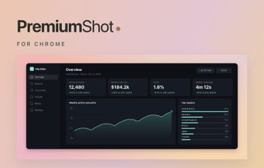

# PremiumShot for Chrome — unlisted store kit

Prepared **2026-10-11**, candidate **0.2.0**. Fabien authorized Claude's B1/B2 release work and a new beta candidate. This is a local submission kit; **no store item has been created, uploaded, submitted or published**.

## What is ready

- [Listing fields](listing.json) and [paste-ready description](listing-description.txt).
- [Single purpose, permissions and data-use drafts](privacy-practices.md).
- [Privacy policy](privacy-policy.md) and [Chrome support copy](support.md) for the shared PremiumShot site.
- [Reviewer instructions](reviewer-notes.txt) and [submission checklist](submission-checklist.md).
- Five current screenshots, starting with capture; the store icon, required small tile and optional marquee.
- A runtime-only upload ZIP with `manifest.json` at its root.

**Upload `out/PremiumShot-Chrome-beta-0.2.0.zip` to Chrome, not the whole kit ZIP.** The companion `out/PremiumShot-Chrome-store-kit-0.2.0.zip` contains that upload ZIP under `upload/`, these documents and the listing artwork.

The manifest controls the name, version and 113-character summary. The detailed description calls this a beta; the accepted product name remains **PremiumShot for Chrome**. Suggested category is Tools / Productivity, subject to the live dashboard's available label. Language is English. Select **Unlisted** on one store item; retain that item's identity for a later public release. Unlisted allows installation by anyone with the URL and still receives review. [Official distribution guide](https://developer.chrome.com/docs/webstore/cws-dashboard-distribution).

## Artwork and screenshot order

| Upload | File | Dimensions | Purpose |
| --- | --- | --- | --- |
| Store icon | `assets/icon-128.png` | 128 × 128 | Existing brand artwork at 96 × 96 with 16 px transparent padding. |
| Screenshot 1 | `assets/01-capture-popup.jpg` | 1280 × 800 | Packaged capture popup at its true 350 × 452 size on a neutral canvas. |
| Screenshot 2 | `assets/02-element-picker.jpg` | 1280 × 800 | Packaged picker frontend selecting a card on the synthetic Meridian webpage. |
| Screenshot 3 | `assets/03-editor-dawn.jpg` | 1280 × 800 | Light editor, five looks, finish controls and PNG exports. |
| Screenshot 4 | `assets/04-editor-tide-dark.jpg` | 1280 × 800 | Dark editor with Tide and 16:9 composition. |
| Screenshot 5 | `assets/05-inspect.jpg` | 1280 × 800 | Real Inspect view at Actual size. |
| Small promo | `assets/promo-small.jpg` | 440 × 280 | Required branded tile using a genuine Chrome Dawn export. |
| Marquee | `assets/promo-marquee.jpg` | 1400 × 560 | Optional wider branded artwork. |



The screenshots capture the shipped frontends served locally. [Popup artwork](source/capture-popup.html) embeds the exact popup HTML without scaling. [Picker artwork](source/capture-picker.html) loads the unchanged `picker.js` over the real DOM of our synthetic fixture; [its adapter](source/capture-picker.js) supplies Chrome messaging and a scripted hover only. It does not call captureVisibleTab or grant permissions. No picker controls are redrawn or invented. The preview adapter and fixture are excluded from the extension upload. This is source-faithful UI artwork, **not loaded-extension capture evidence**; replace the picker image with a real extension screenshot during B6 if available.

The Dawn and Tide editor images retain the prior clean 0.1.4 captures: editor markup, styles, composition and the packaged dashboard are unchanged. Fresh 0.2.0 frontend captures and five downloads were checked separately; Inspect was refreshed from 0.2.0. No customer content, invented browser chrome or credentials are included. Chrome's native screenshot output is JPEG; the files retain that format. Promotional artwork is rendered from [its HTML source](source/promo.html) and a real exported PNG. It is promotional composition, separate from the actual UI screenshots. Source provenance and file hashes are in `validation.json` and `checks.json`.

Only an icon, small promo and at least one screenshot are mandatory; a video is not required. Five distinct screenshots are supplied. Dimensions and padding follow [Chrome's image specification](https://developer.chrome.com/docs/webstore/images).

## Candidate change and checks

0.2.0 replaces the 8 MB base64 session-memory handoff with original-byte PNG blobs in local IndexedDB. The editor consumes/deletes a record atomically; worker startup, expiry, source-tab close and failed editor creation clean pending records. A session-memory marker invalidates disk records after browser/extension restart. The policy describes event-driven cleanup and the possibility of temporary disk retention if Chrome stops. IndexedDB is still subject to Chrome's disk quota; no extra permission is requested.

All **29 unit checks**, **60 native geometry comparisons**, native Chrome storage lifecycle checks and a valid **12,053,779-byte 10,240 × 5,760 PNG** pipeline pass. Five newly downloaded fixture exports are **byte- and pixel-identical** to the accepted exports. Picker, popup, styles, renderer, worker, zoom and appearance modules remain byte-identical to 0.1.4. The native 5K-image check is synthetic; real display capture and a new clean-profile loaded-extension acceptance remain required.

`validation.json` binds the rerun checks to source hashes and records their limits. `checks.json` records file dimensions/encodings, alpha bounds, package CRC, module references, manifest metadata, baseline changes and upload checksums. These checks do not establish loaded-extension integration. The [submission checklist](submission-checklist.md) keeps B3–B6 explicit.

## Remaining external inputs

Fabien plans to buy **premiumshot.app** tonight. The URLs in `listing.json` are planned destinations, not deployed pages:

- Chrome home: `https://premiumshot.app/chrome/`
- Privacy: `https://premiumshot.app/privacy/chrome/`
- Support: `https://premiumshot.app/support/chrome/`

Claude's landing spec calls for one shared domain with `/` for Mac and `/chrome/` for Chrome. The existing private preview and its metadata were not changed in this pass. Public policy/support pages and a privacy link from the shared site's footer are still needed once the public origin and contact are configured.

Publisher registration is pending. A confirmed publisher name and support email are also needed; neither has been invented. The privacy draft has clearly marked tokens for those fields and its effective date. Complete the current account verification and any trader-status questions using the publisher's actual situation. The first beta contains no purchases or subscription features; future pricing remains undecided.

## Reproduce the package

Use Python with Pillow, then run from any directory:

```sh
python3 chrome-web-store/prepare.py
```

The script validates source hashes, current manifest and assets, builds both archives under `out/`, and writes `checks.json`. It does not register, upload, modify hosting, transmit data or publish anything. To regenerate images, serve the repository over localhost. Capture `source/capture-popup.html` at 1280 × 800; open `source/capture-picker.html`, click its preview button and capture at the same size. Editor screenshots use `chrome-extension/editor.html` and its Try an example button. `source/promo.html` renders at 440 × 280 and 1400 × 560.

Official preparation references were checked on 2026-10-10: [package](https://developer.chrome.com/docs/webstore/prepare), [listing](https://developer.chrome.com/docs/webstore/cws-dashboard-listing), [images](https://developer.chrome.com/docs/webstore/images), [privacy fields](https://developer.chrome.com/docs/webstore/cws-dashboard-privacy), and [publication](https://developer.chrome.com/docs/webstore/publish). Field labels can change; confirm the live dashboard before submission.
